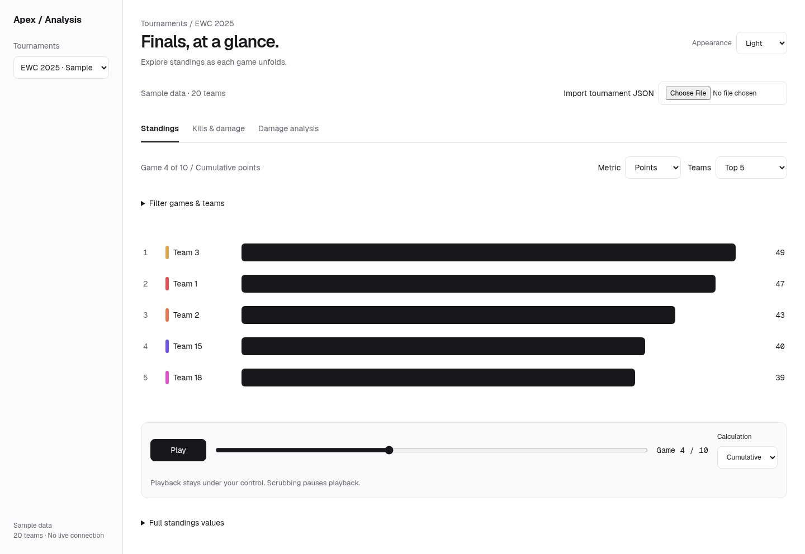
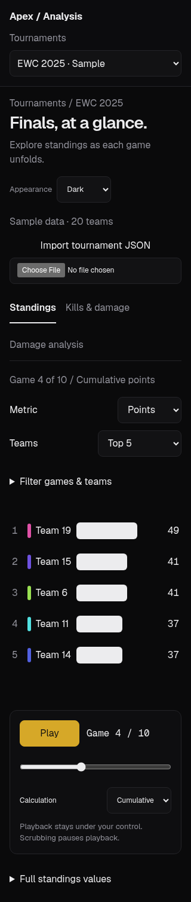

# Apex tournament workspace — LUM candidate implementation

Paper candidate v1 (2026-10-19): https://app.paper.design/file/01M5B2TX4VN6H9B540478BXNNA/p-1-0

This is an implementation of the supplied exact computed-styles, JSX and token readback, including the later leaf font/foreground correction. The candidate is **not user-approved**. Its fictional Practice cup teams were layout examples; Apex retains its existing EWC 2025 generator, all 20 teams by default, explicitly labeled Sample data. The original `tournament-v1.png` was not attached and is not committed. Screens below are actual cloud Chromium captures of this implementation, not Paper exports or a claim of exact final canvas parity.

LUM Brain references read through GitHub:

- `src/styles/design-tokens.ts`, blob `e7e0c2362848c209914a5d9da2bcaa5657b663b8`
- `src/styles/fonts.ts`, blob `d32cace0ed25de3f8e164b9b2d906ca6e782c0e9`
- `src/dashboard-shell-css/primitives.ts`, blob `86324ebdaca47f0837b09c774e31a96f4d81b2d5`
- `src/dashboard-shell-css/shell-chrome.ts`, blob `9678f3e1bf6d00e4f2701b355b8612b2a488574b`

Canonical light/dark semantic palette, dark gold accent with themed `--on-acc`, Geist UI, Geist Mono numeric values, neutral surfaces and the 6/8/10/12/16px radius scale are applied in `src/assets/lum.css`. The 220px sidebar and 32px main inset follow Paper; below 1024px the sidebar becomes a labeled selector, below 768px the inset is 16px. Mobile primary copy is 16px and controls have 44px targets. The shared Locked-In timer token is omitted.

The source/import row, filter disclosure and equivalent values table support the actual workflow beyond the illustrative five-row canvas. The chart region scrolls vertically for all 20 teams. The timeline remains in document flow, never covers content, starts paused at pregame and stops on scrub, data change, unmount or reduced motion. Native range keys support arrows/Home/End. Visualization buttons use pressed state, not incomplete tab semantics. Player points have equivalent named buttons; triangulation and damage breakdown remain contextual. Player totals remain separate when the supplied team aggregate disagrees with player sums.

Font assets are vendored Latin variable WOFF2 files from `@fontsource-variable/geist@5.3.0` and `@fontsource-variable/geist-mono@5.3.0` (npm tarballs); accompanying SIL Open Font Licenses are in `src/assets/fonts/`. No runtime external font request or new package dependency is required. Non-Latin glyphs use the system fallback.

## Actual cloud browser captures

Screens show a user-selected Top 5 at Game 4 for composition; default is all 20. The inherited sample generator is random, so values differ between captures. Browser tests use a fixed two-game fixture to verify exact mathematics.

| Width | Light | Dark |
| --- | --- | --- |
| 320 | [capture](screens/320-light-standings.png) | [capture](screens/320-dark-standings.png) |
| 768 | [capture](screens/768-light-standings.png) | [capture](screens/768-dark-standings.png) |
| 1440 | [capture](screens/1440-light-standings.png) | [capture](screens/1440-dark-standings.png) |

[Scatter with teammate triangulation](screens/1440-dark-scatter.png) · [Damage with player breakdown](screens/1440-dark-damage.png)

Imported player labels use stable IDs because the supplied JSON schema does not link roster names to statistics IDs. Generated sample names retain an explicit generator-owned mapping. [Imported identity regression capture](screens/1440-dark-imported-identity.png).
